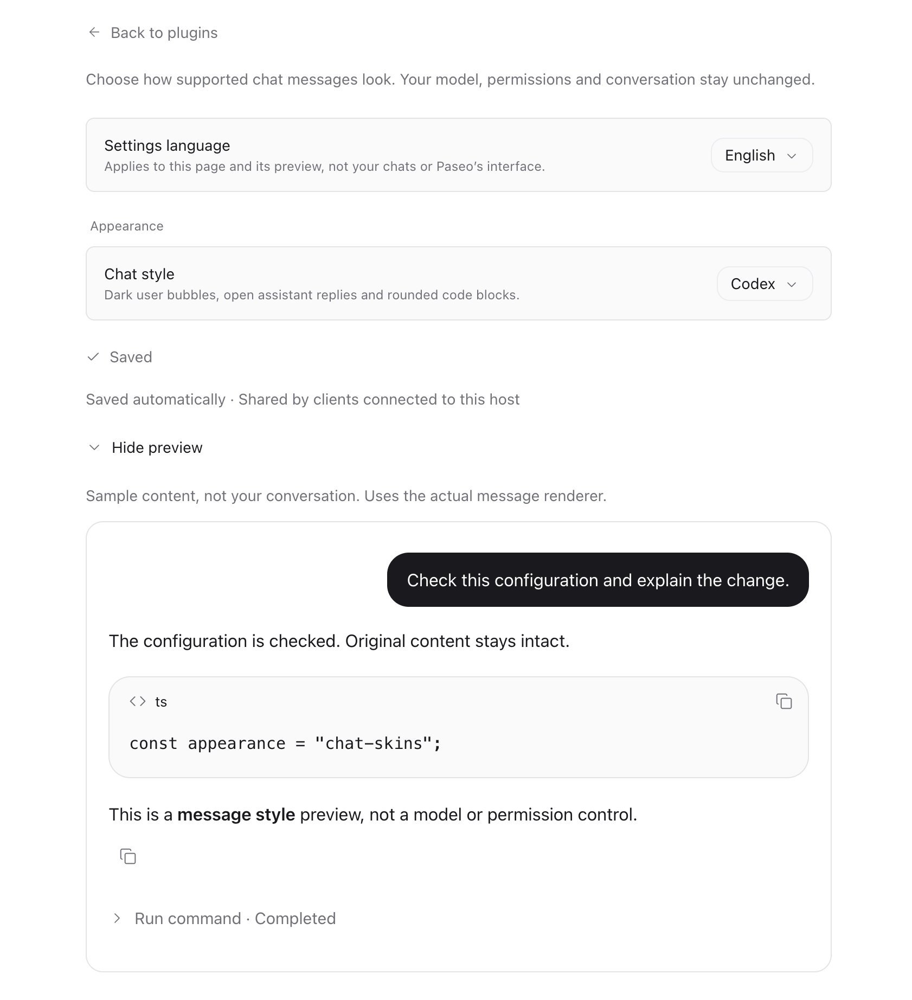
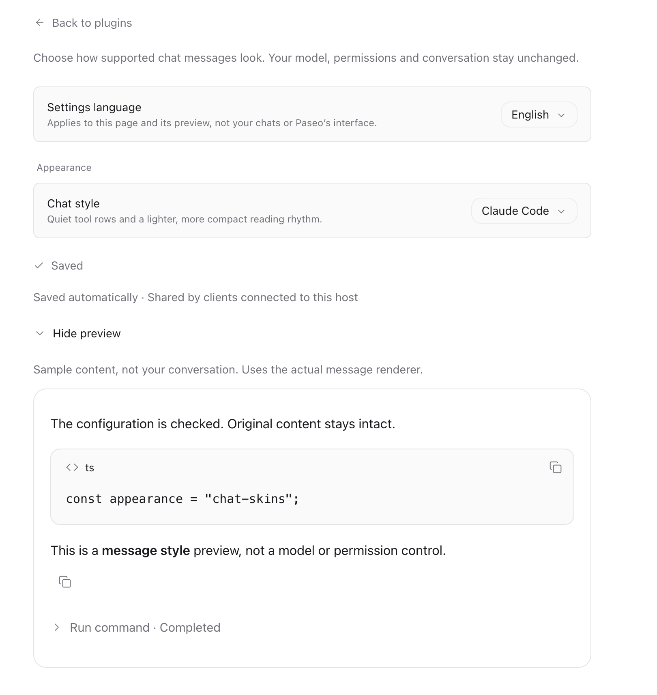
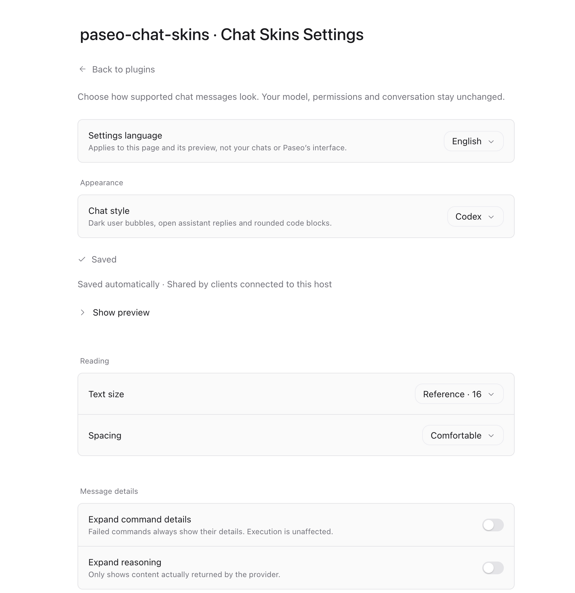

# Chat Skins for Paseo

**English (default)** | [简体中文](./README.zh-CN.md)

Bring familiar **Codex** and **Claude Code** chat styles to Paseo. Customize supported messages, code blocks, tool details and reading preferences, with optional desktop composer styling.

**A skin changes how your chat looks—not which agent runs it.** You can use a Claude Code-inspired appearance while continuing to use Codex, or the other way around.

[Plugin page](https://paseo.sh/plugins/devserra/chat-skins) · [Report an issue](https://github.com/devserra/paseo-chat-skins/issues) · [Created by serra](https://serra.dev)

## Install

Requires **Paseo 0.11.2 or later** on both the host/daemon and the connected app.

Run this on the machine hosting Paseo:

```bash
paseo plugin add devserra/chat-skins
```

Or install through the app:

1. Open **Settings → Plugins** for the host you use.
2. Enter `devserra/chat-skins` in **Plugin source**.
3. Select **Install plugin** and make sure Chat Skins is enabled.

No manual packaging or build is needed for this installation. Plugins are trusted code; review the source before enabling them. If plugins are disabled globally, enable them yourself under **Settings → Plugins** after reviewing that trust decision.

> The short name installs the marketplace's reviewed version. This README describes the current repository; newer changes on `master` are not automatically released to marketplace users. See [Updates](#updates) if an option is missing.

## Start using Chat Skins

1. Open **Settings → Plugins** and find **Chat Skins** (`paseo-chat-skins`).
2. Open its **⋯** menu and select **Chat Skins Settings**. You can also search for **Chat Skins Settings** in Command Center.
3. Under **Chat style**, choose **Codex** or **Claude Code**. New installations use **Paseo native**, so the interface will not change until you choose a skin.
4. Optionally choose a settings language, text size, spacing and default detail expansion. **Show preview** displays sample messages—not your conversation.
5. To style the input area too, enable **Composer → Composer styling**. This is experimental, desktop-only and **off by default**.
6. Return to a chat on the same host. Changes save automatically; no restart or new conversation is required.

Settings are shared by clients connected to the **same host**, not saved separately for each device. The settings language affects this page and its preview only, not your messages or Paseo's interface.

## What the plugin does

| Area | What you get |
| --- | --- |
| Codex messages | Dark user bubbles, open assistant replies and rounded code blocks. |
| Claude Code messages | A lighter reading layout with quiet tool rows and compact spacing. User messages retain Paseo's renderer. |
| Markdown and copying | Common Markdown, monospaced code blocks, and working code/message copy actions. |
| Tool details | Expandable supported shell commands and reasoning; failed commands always show their error details. |
| Reading preferences | Three text sizes and comfortable/compact spacing. |
| Settings languages | English, Simplified Chinese and Hindi. The entry title always remains **Chat Skins Settings**. |
| Optional composer | A rounded Codex input or a compact Claude Code input, using the real host controls. |

### Message and settings previews

These screenshots show message styling and settings. Experimental composer interactions are described in the next section.

| Codex | Claude Code | Settings |
| --- | --- | --- |
|  |  |  |

### Settings at a glance

| Setting | How to use it | Default |
| --- | --- | --- |
| **Settings language** | Choose English, Simplified Chinese or Hindi for settings and preview copy. | English |
| **Chat style** | Choose Paseo native, Codex or Claude Code. | Paseo native |
| **Composer styling** | Enable the optional desktop input/toolbar adaptation. | Off |
| **Text size** | Small · 14, Reference · 16, or Large · 18. | Reference · 16 |
| **Spacing** | Choose Comfortable or Compact for supported message content. | Comfortable |
| **Expand command details** | Expand supported command details by default. Failures stay expanded regardless. | Off |
| **Expand reasoning** | Expand reasoning actually returned by the provider; this does not change reasoning effort. | Off |
| **Restore defaults** | Return to native rendering and default display options, including composer styling off. Keeps the settings language and chat history. | — |

## Optional desktop composer

Select a skin, then turn on **Composer styling**. The adapter targets Paseo **0.11.2's web-rendered desktop composer**. It needs a fine pointer, a viewport at least **900 CSS px** wide and a composer at least **620 CSS px** wide. Narrow panes, native mobile and unrecognized layouts keep the original composer.

### Codex style

- Rounded input with permissions on the left and model/effort controls on the right.
- Click the effort control to open a compact slider when the actual native options can be recognized. Drag and release, or use arrow keys and press Enter, to apply a real available level.
- A real **Ultra** level gets a purple accent. Unknown option sets keep the native list instead.
- The slider's upper-left lightning toggles real **Normal/Fast** modes when available: gray outline when off, solid blue when on. Fast adds subtle track particles, respecting reduced-motion preferences.
- Effort/Fast changes keep the popup open. Click outside or press Esc to close it.
- **Full access** uses a red permission icon; **Default permissions** uses blue. Color does not change the permission itself.

### Claude Code style

- Compact input with attachment, dictation and send/stop actions inside.
- Permissions sit below on the left. Only the **model name** and native context meter sit on the right—no duplicate effort label.
- Click the **model name** for one menu containing the real model list, an **Effort** submenu and a **Fast mode** switch when its state is verifiable.
- Effort/Fast changes keep the main menu open; choosing a model follows native behavior.
- An empty, idle input does not get a synthetic send button. Attachments, queueing, loading, voice availability and stop actions remain host-managed.

### Context window and native behavior

Click the context ring to open its real details; hovering does not open it. After a deliberate click, moving the pointer away does not close or recreate the card. Click outside, click the ring again or press Esc to dismiss. Page/view changes, window blur/resize and the host's external-scroll dismissal still close it safely.

Model, effort, Fast, voice and permission controls use Paseo's actual behavior. Selecting a skin does not change them; explicitly using those controls does. If a provider lacks a feature, the plugin does not invent it. Unknown Fast state, an unidentified new chat or ambiguous panes keep the native Fast entry rather than showing a false switch state.

## Common questions

### I installed it, but nothing changed

- Confirm the plugin is enabled and reports `running` in **Settings → Plugins** or `paseo plugin ls`.
- Open **Chat Skins Settings** and choose a skin; the default is **Paseo native**.
- Message styling and **Composer styling** are separate. Enable the latter if you want the input area to change.
- Widen the window/pane if the composer is unchanged. Check the status beneath its settings switch.
- Another message renderer, such as Beautiful Chat, may take precedence. Try one message-rendering plugin at a time; Chat Skins never disables other plugins automatically.

### Why does the Claude Code skin still show “Codex” in the model menu?

The skin is independent of the actual provider. The menu preserves the real provider and model name. A Codex session using a GPT model is still Codex even with the Claude Code appearance. To change the actual agent, use Paseo's provider/model controls separately.

### How do I go back to Paseo's original appearance?

Choose **Paseo native** to remove this plugin's message and composer adaptations. Turn off **Composer styling** to restore only the input area while keeping message styling. **Restore defaults** also resets reading/detail preferences, but keeps the settings language. You can disable or remove the plugin in **Settings → Plugins**.

### Are these complete app clones?

No. The light-mode macOS interfaces are visual references, not a promise of pixel-perfect parity. The sidebar, workspace tree, window layout and provider behavior are not replaced. Colors adapt to the Paseo theme; dark/mobile fidelity and every input workflow are not fully verified.

Rich attachments, tables, unsupported tools, provider-specific metadata and oversized content stay native. Replacement messages may not expose every host-specific action; switch to native mode for features such as message rewind. Composer styling uses guarded DOM/CSS matching, so host updates or conflicting adapters can cause it to fall back to native. See [architecture and boundaries](./docs/architecture.md) for details.

## Updates

Check for an update, then review and approve it:

```bash
paseo plugin update paseo-chat-skins --check
paseo plugin update paseo-chat-skins
```

Marketplace installs follow the **approved registry revision**, not every push to this repository. `paseo plugin reload` reloads installed code; it does **not** download or publish an update.

For an intentional direct-source installation instead of the reviewed marketplace artifact:

```bash
paseo plugin add git:devserra/paseo-chat-skins --ref master
```

This is the development source, not the marketplace release. Avoid duplicate active installations. Follow the [official plugin guide](https://paseo.sh/docs/plugins.md) when changing an existing installation's source.

## Local development

Use **Node.js 22.18+** (or Node.js 24) and npm:

```bash
git clone https://github.com/devserra/paseo-chat-skins.git
cd paseo-chat-skins
npm ci --ignore-scripts
npm run check
npm pack --dry-run
paseo plugin install "$(pwd)"
```

After changing local source:

```bash
npm run check
paseo plugin reload paseo-chat-skins
```

`check` runs strict TypeScript checking, not runtime or visual acceptance. Automated test source, local fixtures and internal QA artifacts are intentionally excluded from this repository and package. No manual bundle is required for the current source-based installation; do not restart the daemon just to reload local plugin code.

- [Architecture and source layout](./docs/architecture.md)
- [Paseo plugin reference](https://paseo.sh/docs/plugins/reference)
- [Publishing guide](https://paseo.sh/docs/plugins/publishing.md)

---

Created by [serra](https://serra.dev). Independent project; not affiliated with OpenAI or Anthropic. Product names identify appearance references. The plugin does not send conversation data to external services, and no private reference screenshots or original product assets are distributed.
